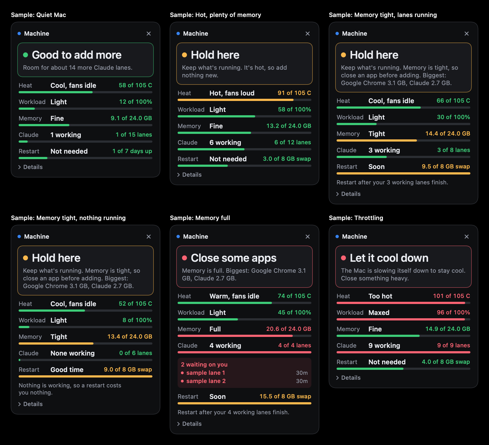

# Machine Tile

A small floating panel for Apple Silicon Macs that tells you at a glance whether your Mac can take
more work. Menu bar app, no Dock icon. Built with `swiftc` alone: no Xcode project, no Homebrew, no
dependencies, and no special permissions.



## Install

You need the Xcode Command Line Tools (`xcode-select --install`).

```bash
git clone https://github.com/allstarszn/machine-tile.git
cd machine-tile
./install.sh
```

Open or close it with `⌃⌥⌘M` (control, option, command, M), or click the gauge icon in the menu bar.
Right-click the icon to quit.

## What it shows

The top line says what to do right now:

| Answer | Meaning |
|---|---|
| **Good to add more** | Start more work. It says about how many more Claude sessions fit. |
| **Hold here** | Keep what is running and do not add anything new. |
| **Close some apps** | Memory is full, and it names the two biggest apps. |
| **Let it cool down** | The Mac is slowing itself down because of heat. |

Below that, each row has a word, a filled bar and the number behind it:

| Row | What it measures |
|---|---|
| **Heat** | The hottest CPU or GPU core sensor, plus fan state. |
| **Workload** | How busy the CPU is. |
| **Memory** | RAM in use. The word comes from macOS memory pressure and swap, not from this number alone. |
| **Claude** | Claude Code sessions working, out of how many fit. |
| **Restart** | How close you are to a restart being worthwhile: 8 GB of swap or 7 days up. |

`Details` opens every raw number, plus the biggest apps. It polls every 2 seconds, only while open.

The Claude row needs [Claude Code](https://claude.com/claude-code) at `~/.local/bin/claude`. Without
it the tile says so and everything else still works.

## Numbers worth knowing

The thresholds live in `Verdict` in `MachineModel.swift`. They are stated choices sized for a 24 GB
Mac, so change them to suit yours.

- **105 C at the top of the heat bar is a choice.** Apple does not publish a limit.
- **Sensor names are inferred.** Apple does not document them. The tile uses the convention other
  Apple Silicon readers use, and says "degrees unavailable" rather than inventing a number.
- **Swap is judged in GB, not percent,** because macOS resizes the swap file itself.

To check any number against the command line:

```bash
"build/Machine Tile.app/Contents/MacOS/MachineTile" --machine-dump
```

## Privacy

Machine Tile makes no network connections, has no telemetry and holds no accounts or keys. It only
touches your own Mac:

- It reads system stats, and `~/.claude/metrics/costs.jsonl` if that file exists.
- It runs `claude agents --json` locally.
- It stores its panel position in macOS preferences.

## Uninstall

```bash
launchctl bootout "gui/$UID/com.machinetile.app"
rm -rf ~/Applications/"Machine Tile.app" ~/Library/LaunchAgents/com.machinetile.app.plist
```
